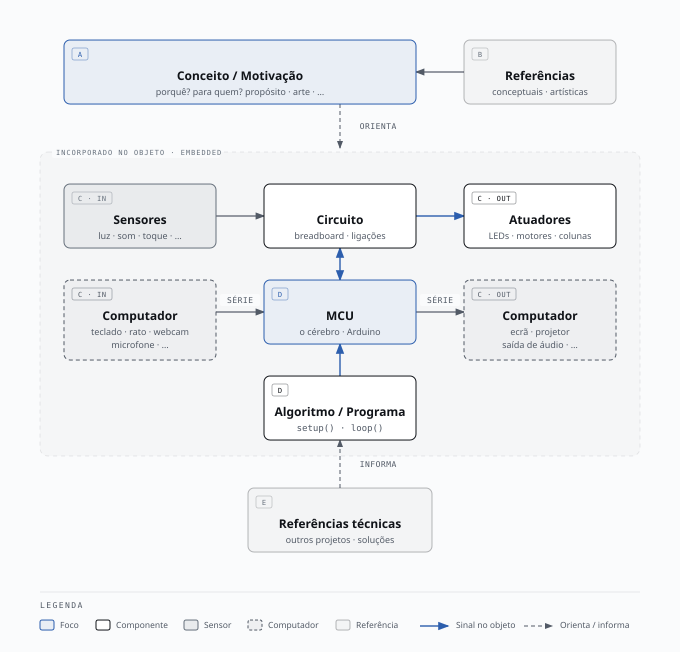

# Atividades e Workshops

## Abordagem

A UC de Design de Inovação está organizada em **blocos temáticos**, cada um composto por workshops práticos e exercícios curtos que se encerram numa única entrega. Os blocos exploram diferentes ferramentas e conceitos de inovação em design, partindo sempre da prática.

Alguns exercícios poderão contribuir diretamente para o projeto final de **Design de Produto e Interação I** ((com)FORMA), nomeadamente na geração de formas, na prototipagem de interações e na documentação. A articulação entre as duas UC é intencional e incentivada.

## Estrutura do Semestre

| Bloco | Aulas | Período | Tema |
|-------|-------|---------|------|
| **1. Código Criativo** | 1–4 | 25 Set – 16 Out | Geração de formas e padrões com programação visual; AI e bibliotecas |
| **2. Computação Física** | 5–8 | 23 Out – 13 Nov | Sensores, atuadores e interações tangíveis; Exercício Final em dupla (entrega a 4 Dez) |
| **3. Laboratório de Projeto** | 9–14 | 20 Nov – 8 Jan | Apoio aos projetos (com)FORMA e Exercício Final de Computação Física (este até 4 Dez) |

---

## Bloco 1: Código Criativo

**Aulas 1–4** · 25 Set, 2 Out, 9 Out, 16 Out

### Objetivos

- Introduzir ferramentas de programação visual para geração de formas
- Explorar padrões, simetrias e sistemas modulares através de código
- Produzir composições visuais ou modelos paramétricos que possam informar projetos de design
- Explorar AI (LLMs, Copilot) como ferramenta de expansão da capacidade criativa com código
- Introduzir bibliotecas e estruturas de projetos mais complexos

### Ferramentas

- [Processing](https://processing.org/) / [p5.js](https://p5js.org/)
- ChatGPT / Claude / Gemini — assistentes de código com LLMs
- GitHub Copilot / Cursor — assistentes de código integrados no editor
- Opcionalmente: Grasshopper (Rhino), OpenSCAD

### Exercícios

| Exercício | Descrição |
|-----------|-----------|
| **Ex01 — Mondrian** | Reprodução fiel de Mondrian em código + destabilização generativa |
| **Ex02 — if/else** | Composição interativa com condicionais |
| **Trabalho Final** | Output generativo com potencial de aplicação no projeto de DPI |

**Entrega via Moodle:** Ex01 até à Aula 5 (23 de outubro); Ex02 e Trabalho Final até à Aula 7 (6 de novembro). Cada exercício: repositório GitHub + GitHub Pages + `readme.md` como memória descritiva.

### Articulação com DPI

As formas e padrões gerados neste bloco podem servir como ponto de partida para a geometria modular do (com)FORMA — explorar computacionalmente as possibilidades de composição antes de as materializar.

---

## Bloco 2: Computação Física

**Aulas 5–7** · 23 Out, 30 Out, 6 Nov · **Exercício Final** lançado na Aula 8 (13 Nov), entrega até **4 de dezembro (Aula 11)**

### Objetivos

- Introduzir conceitos de eletrónica básica e programação de microcontroladores
- Explorar interações tangíveis: como objetos físicos podem responder ao contexto
- Prototipar rapidamente comportamentos interativos
- Documentar e partilhar um projeto de forma aberta, num repositório GitHub

### Ferramentas

- Arduino UNO, programado no VSCode com PlatformIO — ver [Computação Física com Arduino](../Recursos/ComputacaoFisicaArduino.md)
- GitHub + GitHub Desktop (repositório partilhado pela dupla)
- Sensores (luz, som, toque, distância, movimento, …) e atuadores (LEDs, motores, colunas, …)

### Exercício Final de Computação Física

Em **dupla**, conceber e prototipar um objeto que **sente** o contexto ou o utilizador (input), **decide** (MCU + algoritmo) e **responde** (output), com a eletrónica **incorporada no objeto** (*embedded*). O foco está na qualidade da interação e na coerência entre conceito e solução técnica, não na complexidade técnica.

#### Matriz de trabalho

O projeto desenvolve-se a partir desta matriz, apresentada na [Aula 8](Sumarios/aula8.md), onde está também o **canvas** para preencher em dupla no Miro:

| | Ponto da matriz | O que definir |
|---|---|---|
| **a** | Conceito / Motivação | Porquê este objeto, para quem, o que deve provocar (propósito, intenção artística, …) |
| **b** | Referências | Referências conceptuais, artísticas e de design que sustentam o conceito |
| **c** | Inputs / Outputs | O que o objeto sente (sensores: luz, som, toque, …) e o que faz (atuadores: LEDs, motores, colunas, …). Pela porta série, o **computador** pode ser input (teclado, rato, webcam, microfone, …) e output (ecrã, projetor, saída de áudio, …), como no Trabalho Final de Código Criativo em p5.js |
| **d** | MCU + Algoritmo | A lógica do programa: o que acontece a cada volta do `loop()`, regras e limiares que decidem o comportamento |
| **e** | Referências técnicas | Outros projetos e soluções semelhantes, tutoriais e documentação usados |

#### Entregáveis — tudo no GitHub

**Um único repositório por dupla**, criado a partir do [arduinoStarterTemplate](https://github.com/steam228/arduinoStarterTemplate):

- O segundo elemento é adicionado como colaborador (**Settings → Collaborators → Add people**) e ambos fazem *commits*
- Código em `src/main.cpp` (projeto PlatformIO, a começar por `#include <Arduino.h>`), comentado
- Imagens e outros ficheiros de apoio numa pasta `media/`

O **`README.md` é a memória descritiva** e contém, por esta ordem:

1. Título do projeto e nomes dos dois elementos da dupla (com turma)
2. **a) Conceito / Motivação**
3. **b) Referências** — com links ou imagens e uma frase sobre o que se retira de cada uma
4. **c) Inputs / Outputs** — lista de componentes e função de cada um; se houver ligação ao computador, o que circula pela porta série e em que sentido (com link para o sketch p5.js e respetiva GitHub Pages)
5. **Esquema do circuito** — esquema desenhado (Tinkercad, Fritzing ou à mão) e/ou fotografia legível da montagem
6. **d) MCU + Algoritmo** — explicação do funcionamento (texto, fluxograma ou pseudocódigo) e calibração: valores lidos no Serial Monitor e limiares escolhidos
7. **e) Referências técnicas** — links e o que foi aproveitado de cada uma
8. **Registo do protótipo** — fotografias e vídeo de demonstração (máx. 60 s), publicado no YouTube/Vimeo com link no README ou incluído no repositório
9. **Processo** — dificuldades, iterações e possível articulação com o (com)FORMA
10. **Uso de IA** — que ferramentas foram usadas e para quê

Guia de formatação: [Markdown](../Recursos/markdown.md).

**Entrega:** link do repositório submetido no Moodle até **4 de dezembro (Aula 11)**. O protótipo é apresentado em aula.

#### Critérios

| Critério | Descrição |
|----------|-----------|
| **Conceito e referências** (a, b) | Clareza da motivação e pertinência das referências |
| **Interação** (c, d) | Coerência entre inputs, algoritmo e outputs face ao conceito; protótipo funcional |
| **Fundamentação técnica** (e) | Uso e citação de referências técnicas e de soluções semelhantes |
| **Documentação** | README completo segundo a matriz, esquema, código comentado, registo em vídeo |
| **Colaboração** | Repositório partilhado com contributos dos dois elementos da dupla |

### Articulação com DPI

A computação física pode acrescentar uma camada funcional/interativa às peças modulares do (com)FORMA — por exemplo, módulos que incorporam sensores, luz ou som.

---

## Bloco 3: Laboratório de Projeto

**Aulas 9–14** · 20 Nov, 27 Nov, 4 Dez, 11 Dez, 18 Dez, 8 Jan

As aulas passam a funcionar em **modo laboratório**: toda a gente a trabalhar nos projetos, com apoio do professor. Até à entrega de 4 de dezembro (Aula 11), o apoio divide-se entre o **Exercício Final de Computação Física** e o **(com)FORMA**; depois dessa data, as aulas ficam dedicadas ao (com)FORMA.

Em DI, o (com)FORMA é avaliado quanto à **documentação** e à **integração dos processos e ferramentas** abordados em DI (código criativo, computação física, GitHub), e à sua pertinência. A documentação aberta do projeto liga-se a um dos temas do programa — **Open Design e Distributed Design**: documentação, publicação e partilha de projetos.

| Marco | Data |
|-------|------|
| Entrega do CAD do molde (DPI I) | 24 Nov |
| Entrega do Exercício Final de Computação Física (DI) | 4 Dez (Aula 11) |
| Protótipo funcional do (com)FORMA (DPI I) | 15 Dez |
| Entrega final do (com)FORMA (DPI I) | 5 Jan |

As aulas de DPI I de 1 e 8 de dezembro coincidem com feriados; as sessões de DI de 4 e 11 de dezembro são as oportunidades de apoio presencial nessas semanas. Ver os [sumários](Sumarios/index.md) e o [calendário](Calendario.md).

## Avaliação

A avaliação de DI integra três componentes:

| Componente | Modalidade |
|------------|------------|
| **Computação Criativa** (Bloco 1) | Individual |
| **Computação Física** — Exercício Final (Bloco 2) | Duplas |
| **Projeto (com)FORMA** — documentação e integração dos processos e ferramentas abordados em DI, e a sua pertinência | Grupo |

Em cada componente consideram-se:

| Critério | Descrição |
|----------|-----------|
| **Execução** | O exercício foi completado e entregue dentro do prazo |
| **Exploração** | Os estudantes foram além do mínimo e experimentaram variações |
| **Documentação** | O processo está registado de forma clara e partilhável |
| **Articulação** | O trabalho dialoga com o projeto de DPI (quando aplicável) |
