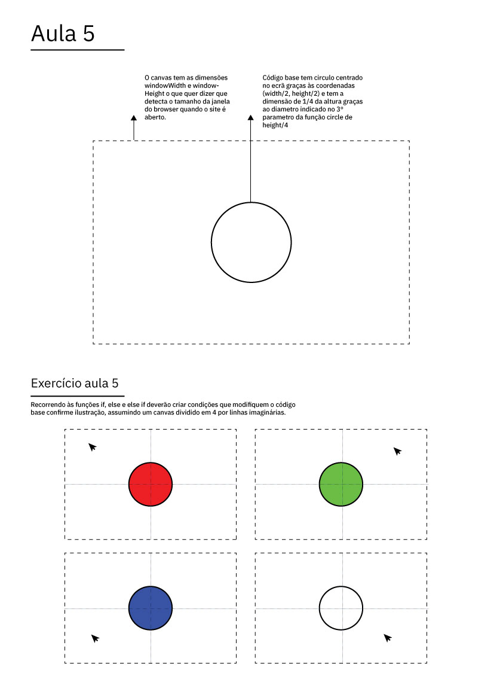
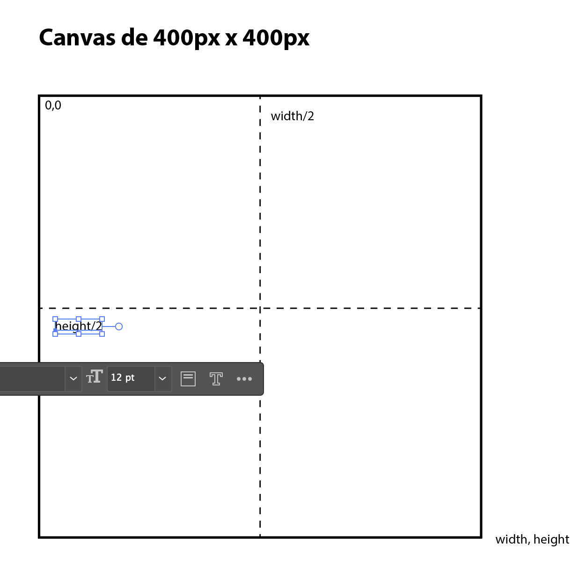

# Aula 3 — Código Criativo III

## Data

**9 de outubro de 2026** (6ª feira)

## Sumário

- Interação e animação: parâmetros que mudam com o tempo ou com o utilizador
- Exportação de resultados: imagem, vídeo, SVG
- Sessão de trabalho: finalização do exercício
- Apresentação e discussão dos resultados em aula

## Notas da Aula


## Revisão da Aula anterior

```javascript

let divs;

function setup() {

	createCanvas(windowWidth, windowHeight);
	background(0);
	frameRate(4);
	divs = 10;
	noStroke();
	fill(255);

}

  

function draw() {

	background(0); 

	for (let i = 1; i < divs; i++) {
		for (let j = 1; j < divs; j++) {
			let x = (i * width) / divs;
			let y = (j * height) / divs;
			let xC = random(x - 4, x + 4);
			let yC = random(y - 4, y + 4);
			circle(xC, yC, 20);
		}
	}
}

  

function windowResized() {
	resizeCanvas(windowWidth, windowHeight);
}

```
### Conceitos introduzidos

### Condicionais — `if` / `else`



```js
function setup() {
  createCanvas(windowWidth, windowHeight);
  frameRate(14);
  noFill();
  stroke(0);
}

function draw() {
  background(255);

  if (mouseX < width/2) {
    if (mouseY > height/2) {
      fill(255, 0, 0);
    } else {
      fill(0, 255, 0);
    }
  } else {
    if (mouseY > height/2) {
      fill(0, 0, 255);
    } else {
      noFill();
    }
  }

  strokeWeight(random(2, 20));
  circle(width/2, height/2, height/4);
}
```

#### Variação — desenho cumulativo por quadrante



```js
function setup() {
  createCanvas(600, 600);
  background(255);
}

function draw() {
  noStroke();
  if (mouseX < width / 2) {
    if (mouseY < height / 2) {
      fill(255, 0, 0);
    } else {
      fill(0, 255, 0);
    }
  } else {
    if (mouseY < height / 2) {
      fill(0, 0, 255);
    } else {
      fill(0);
    }
  }
  circle(mouseX, mouseY, 20);
}
```


- `mouseX`, `mouseY` — interação com o rato
- `frameCount`, `sin()`, `cos()` — animação e movimento cíclico
- `save()`, `saveCanvas()` — exportar imagens
- Exportação SVG para fabricação (corte laser, vinil)

---

## Ex02 — if/else

### Enunciado

Criar uma **composição interativa** que use condicionais (`if`/`else`) para alterar o comportamento visual com base na posição do rato, teclas pressionadas ou outros inputs.

!!! info "Prazo e ferramenta"
    **Entrega via Moodle até à Aula 7 (6 de novembro).**

    Trabalha em **p5.js no VSCode**, a partir do template base (ver [Configuração Base P5JS](../../Recursos/CodigoCriativocomP5JS.md)).

#### Objetivo

Explorar a tomada de decisão no código — como o programa reage a diferentes condições e como isso gera variação visual.

#### Requisitos

- Usar pelo menos **duas condições** (`if`/`else`) que alterem cores, formas ou comportamentos
- O resultado deve ser **visualmente interessante** — não basta funcionar, tem de comunicar
- Pode partir dos exemplos da aula ou criar algo de raiz

### Entrega

Via **[Moodle](https://moodle2627.ipl.pt/course/section.php?id=9701)**, até à Aula 7 (6 de novembro).

O exercício é um **repositório GitHub**, criado a partir do template base. Submeter no Moodle:

| O que submeter | Descrição |
| -------------- | --------- |
| Link do repositório | ex: `https://github.com/username/Ex02-nome` |
| Link da página (GitHub Pages) | ex: `https://username.github.io/Ex02-nome/` |

O repositório deve incluir um **`readme.md`** com uma breve memória descritiva: que condições usaste, como afetam o resultado visual, e o que exploraste.

---

### Entregas — Bloco 1 (resumo)

| Exercício | Lançamento | Prazo | Descrição |
|-----------|------------|-------|-----------|
| **Ex01 — Mondrian** | [Aula 2](aula2.md) | Aula 5 (23 Out) | Reprodução fiel + desestabilização generativa |
| **Ex02 — if/else** | Aula 3 | Aula 7 (6 Nov) | Composição interativa com condicionais |
| **Trabalho Final** | [Aula 4](aula4.md) | Aula 7 (6 Nov) | Artefacto digital — framework Ingredientes |

Todas as entregas são via **[Moodle](https://moodle2627.ipl.pt/course/section.php?id=9701)** — submeter os links dos repositórios GitHub e das respetivas páginas (GitHub Pages). Cada repositório deve incluir um `readme.md` como memória descritiva. Ver [workflow de configuração](../../Recursos/CodigoCriativocomP5JS.md).
