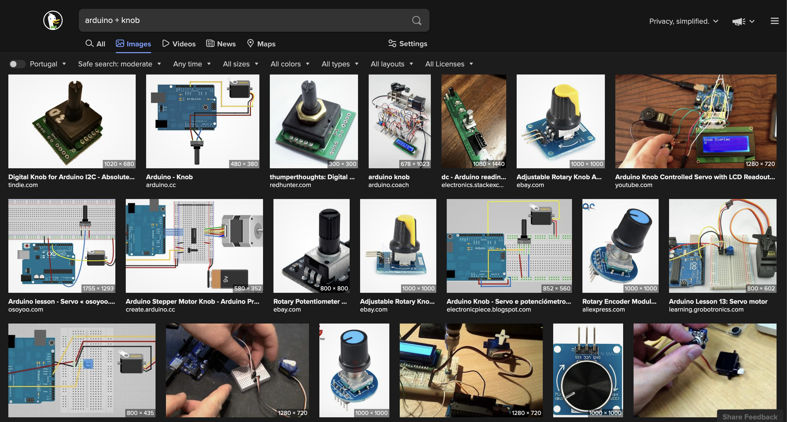
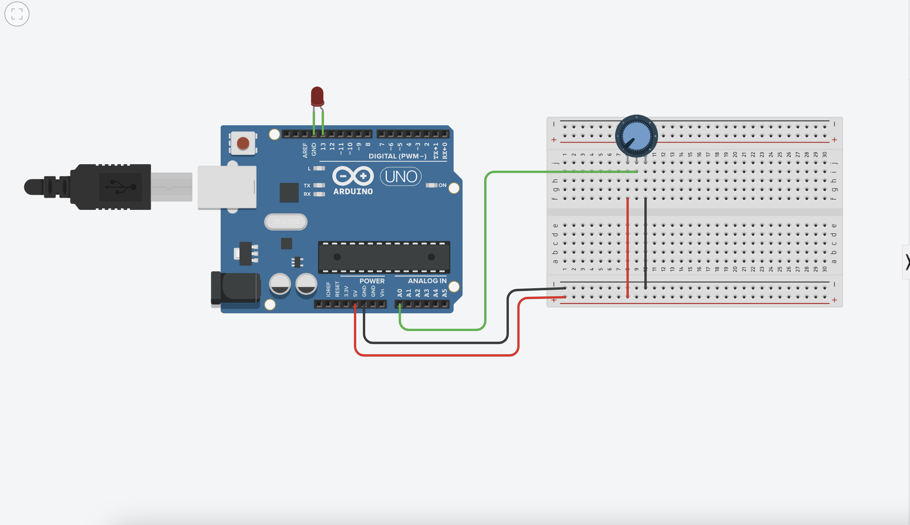
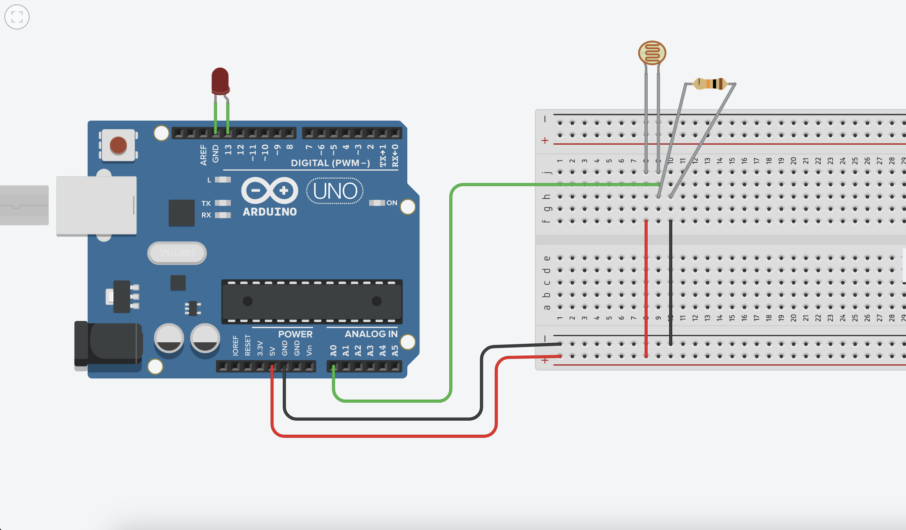
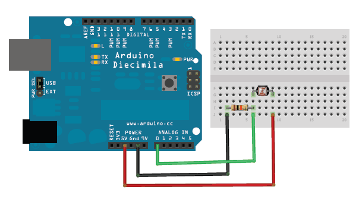

# Aula 7 — Computação Física II

## Data

**6 de novembro de 2026** (6ª feira)

## Sumário

- Conversão Analógico-Digital (ADC) — leitura de sensores analógicos
- Comunicação pela porta série (`Serial`)
- Breadboard: como funciona e como montar um circuito
- LDR (sensor de luz): montagem do circuito, leitura e tomada de decisão
- Calibração de um sensor com o Monitor Série
- Potenciómetro: leitura e mapeamento de valores (opcional, para experimentar)
- Introdução ao conceito de protótipo de interação
- Entrega dos exercícios do Bloco 1 (Código Criativo)

!!! info "Criar novo projeto Arduino — passo a passo"
    1. Abrir o [**template base**](https://github.com/steam228/arduinoStarterTemplate) no GitHub
    2. **Use this template** → **Create a new repository** → dar um nome (ex.: `02ExpLDR`) e uma descrição
    3. **Trabalho em grupo:** no repositório, **Settings** → **Collaborators** → **Add people** → adicionar os colegas de grupo (username, nome ou email). Cada colega tem de aceitar o convite
    4. **Open with GitHub Desktop** (ou **File → Clone repository**) → clonar para o computador, escolhendo bem a pasta de destino
    5. No VSCode: **PIO Home** → **Projects** → **Add Existing** → escolher a pasta → **Open**. Se o projeto não aparecer na lista, sair de **Projects** e voltar a entrar
    6. Em `src/main.cpp`, apagar o código do template (é um exemplo para estudar), mantendo a linha `#include <Arduino.h>`, e colar o código da experiência
    7. **Build** (✓) para verificar → **Upload** (→) para a placa

    Guia completo com vídeo: [Computação Física com Arduino](../../Recursos/ComputacaoFisicaArduino.md)

## Vídeos da Aula

**Parte 1 — Criar o projeto e colaborar no GitHub** (repositório a partir do template, colaboradores, clonar e abrir no PlatformIO)

https://youtu.be/XsQgBjsYPnE

**Parte 2 — LDR: breadboard, circuito, código e calibração**

https://youtu.be/tqKE-yUDpBs

## Notas da Aula

### Analog to Digital — ADC + Comunicação Porta Série



### Potenciómetro

!!! note "Opcional"
    Na aula passámos diretamente ao LDR. O potenciómetro fica como experiência para fazer mais tarde: o circuito e a lógica de leitura são os mesmos, com a novidade do `map()`.

```arduino
#include <Arduino.h>
#define ledPin 13

int sensorValue = 0;
int angulo = 0;

void setup() {
  Serial.begin(9600);
  pinMode(ledPin, OUTPUT);
  digitalWrite(ledPin, LOW);
}

void loop() {
  sensorValue = analogRead(A0);
  angulo = map(sensorValue, 0, 1023, 0, 360);
  if (angulo >= 180) {
    digitalWrite(ledPin, HIGH);
  } else {
    digitalWrite(ledPin, LOW);
  }

  Serial.println(angulo);
  delay(1);
}
```



### LDR — Sensor de Luz

Referências:

- [How to use an LDR with Arduino](https://maker.pro/arduino/tutorial/how-to-use-an-ldr-sensor-with-arduino)
- [Photocells — Adafruit](https://learn.adafruit.com/photocells/connecting-a-photocell)

#### A breadboard

- Os furos estão ligados entre si em **filas de 5** (na zona central): tudo o que se espeta na mesma fila fica ligado.
- As **linhas compridas** das extremidades (marcadas `+` e `−`) estão ligadas ao longo de toda a placa: servem para distribuir os **5V** e o **GND (ground)**.
- Os fios e os componentes ligam-se pressionando com firmeza até ficarem presos. Um fio mal encaixado dá **mau contacto**, que é a causa mais comum de "não funciona".

#### O circuito



- **5V** do Arduino → linha `+` → uma perna do **LDR**. O LDR **não tem polaridade** (é indiferente a orientação).
- A outra perna do LDR liga a dois sítios: ao pino **A0** (fio verde, leitura analógica) e a uma **resistência de 10 kΩ**.
- A resistência de 10 kΩ liga ao **GND**. É uma **resistência pull-down**: mantém o sinal estável quando não há leitura. Uma *breakout board* de sensor de luz já traz normalmente esta resistência integrada.
- **LED**, como no *Blink* da aula anterior: perna **comprida** (+) no pino **13**, perna **curta** (−) no **GND**. Ao contrário do LDR, o LED só funciona num sentido.

!!! tip "Esquema vs. montagem"
    O esquema usa as linhas `+` e `−` para que o circuito possa crescer (há sempre 5V e GND à mão para novos componentes). Pode montar-se o mesmo circuito de forma mais compacta, com menos fios, ligando diretamente aos pinos 5V e GND. As pernas dos componentes podem ser afastadas para facilitar. O importante é **compreender o circuito**, não copiar a posição exata de cada fio.

Versão simples — ler o sensor e acender LED quando escurece:



```arduino
#include <Arduino.h>
#define sensLuz A0
#define ledPin 13

int valorSensLuz = 0;
int asEscuras = 200;

void setup() {
  Serial.begin(9600);
  pinMode(ledPin, OUTPUT);
  digitalWrite(ledPin, LOW);
}

void loop() {
  valorSensLuz = analogRead(sensLuz);
  Serial.println(valorSensLuz);
  if (valorSensLuz < asEscuras) {
    digitalWrite(ledPin, HIGH);
  } else {
    digitalWrite(ledPin, LOW);
  }
  delay(1);
}
```

Como ler o código: o LDR está no `A0` e o LED no `13`; `valorSensLuz` guarda a leitura e `asEscuras` é o **limiar** a partir do qual se considera que está escuro. No `loop()`, a cada volta, lê-se o sensor, escreve-se o valor na porta série e decide-se com `if / else` (tal como no P5.js): abaixo do limiar liga o LED, caso contrário desliga.

#### Calibrar o sensor

O valor `200` é um ponto de partida: o que significa "às escuras" depende do sensor e da luz da sala. Para calibrar:

1. Com o código carregado, abrir o **Serial Monitor** (ícone da ficha 🔌 na barra inferior).
2. Observar os valores com o sensor destapado, tapado com um dedo, tapado com a mão e com uma lanterna apontada.
3. Escolher o valor de `asEscuras` que corresponde ao comportamento pretendido.
4. **Fechar o Serial Monitor** antes de voltar a fazer **Upload**: enquanto está aberto, ocupa a porta e o upload falha.

Valores de referência medidos na aula (vão variar):

| Situação | Leitura aproximada |
| --- | --- |
| Lanterna apontada | ~1017 |
| Luz ambiente da sala | ~400–575 |
| Tapado com um dedo | ~260 |
| Tapado com a mão | ~70 |

Mais luz → menor resistência do LDR → valor mais alto. Um limiar baixo (ex.: `80`) torna o LED mais "exigente", e perto do limiar a leitura oscila e o LED fica instável.

!!! warning "Se o LED não reage"
    Ver primeiro o Serial Monitor: se os valores não mudam quando se tapa o sensor, é provável que haja um mau contacto na breadboard. Se mudam mas o LED não acende, ajustar `asEscuras`.

### Conceitos-chave

- `analogRead()` — leitura de valor analógico (0–1023)
- `map()` — traduzir um intervalo de sensor para um intervalo de atuador
- `Serial.println()` — comunicação com o computador pela porta série
- Divisor de tensão: princípio base dos sensores resistivos (LDR, termístor, FSR). O LDR e a resistência de 10 kΩ dividem os 5V e o `A0` lê a tensão no ponto entre os dois
- Resistência pull-down: resistência entre a linha de sinal e o GND que estabiliza a leitura na ausência de sinal
- Limiar (*threshold*) e calibração: o valor de decisão define-se a partir de leituras reais, observadas no Serial Monitor

### Articulação com DPI

Pensar como os módulos do (com)FORMA poderiam incorporar eletrónica simples: um módulo com LED, um módulo sensível ao toque, um módulo que reage à luz.

---

### Entrega — Bloco 2

**Exercício: Protótipo de Interação**

Criar um protótipo funcional que responde a um estímulo do ambiente ou do utilizador.

Entregar:

- Protótipo funcional (apresentado em aula)
- Vídeo de demonstração (máx. 60 segundos)
- Texto descritivo (máx. 200 palavras)

### Balanço dos blocos 1 e 2

Discussão coletiva: que ferramentas e conceitos dos dois primeiros blocos são úteis para o (com)FORMA? Como integrar código criativo e computação física no design de produto?
