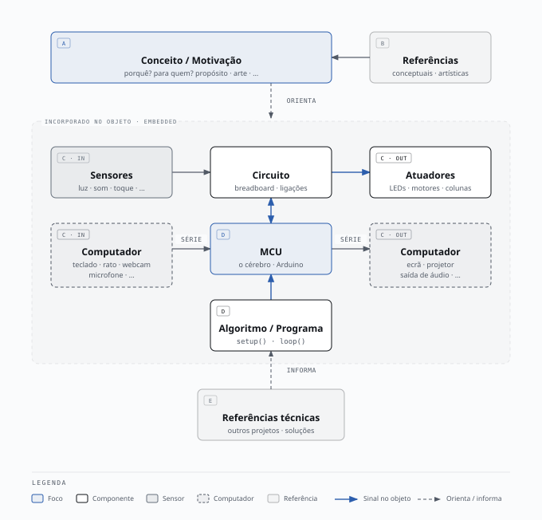
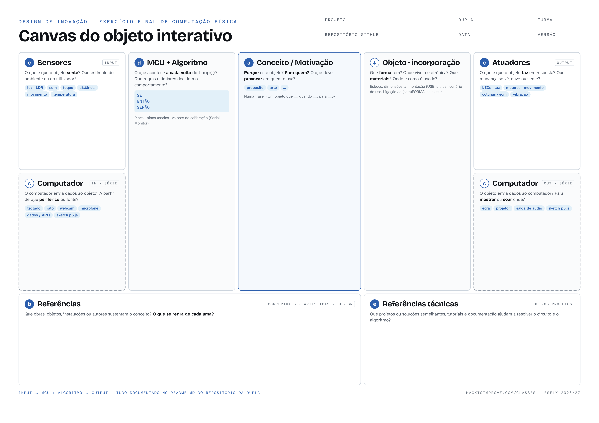

# Aula 8 — Exercício Final de Computação Física

## Data

**13 de novembro de 2026** (6ª feira)

## Sumário

1. Continuação da aula anterior
2. Lançamento do Exercício Final de Computação Física (entrega até 4 de dezembro)
3. Matriz de trabalho para o Exercício Final e discussão de possibilidades:
    - a) Conceito / Motivação
    - b) Referências
    - c) Inputs / Outputs
    - d) MCU + Algoritmo
    - e) Referências técnicas: outros projetos
4. Partilha de referências em aula (conceptuais, artísticas, de design e técnicas)
5. Clarificação da integração entre DPI I e DI e respetiva avaliação

---

## 1. Continuação da aula anterior

Retoma dos conteúdos da [Aula 7](aula7.md): montagem do circuito do LDR na breadboard, leitura analógica, comunicação pela porta série e calibração do sensor com o Serial Monitor.

- Vídeos e notas: [Aula 7 — Computação Física II](aula7.md)
- Configuração do projeto (template, PlatformIO, GitHub): [Computação Física com Arduino](../../Recursos/ComputacaoFisicaArduino.md)

---

## 2. Lançamento do Exercício Final

Em **dupla**, conceber e prototipar um objeto que **sente** o contexto ou o utilizador (input), **decide** (MCU + algoritmo) e **responde** (output), com a eletrónica incorporada no próprio objeto.

!!! info "Entrega até 4 de dezembro (Aula 11)"
    - **Um repositório GitHub por dupla**, criado a partir do [arduinoStarterTemplate](https://github.com/steam228/arduinoStarterTemplate), com o colega adicionado como colaborador
    - **Todos os entregáveis no repositório**, documentados no `README.md`: conceito, referências, inputs/outputs, esquema do circuito, algoritmo, código, referências técnicas, fotografias e vídeo
    - Link do repositório submetido no Moodle

    Enunciado completo: [Exercício Final de Computação Física](../Enunciado.md)

---

## 3. Matriz de trabalho

A matriz organiza o projeto e corresponde às secções do `README.md`.

**Para colaboração em grupo importem este canvas para um board de miro ou outra ferramenta que usem para colaborar, assim poderão associar imagens, links, post its para construir o vosso mapa de trabalho:**

### a) Conceito / Motivação

Porquê este objeto? Para quem? O que deve provocar? A motivação pode ser um propósito (resolver, ajudar, informar) ou uma intenção artística/expressiva. É o conceito que orienta todas as escolhas técnicas seguintes.

### b) Referências

Referências conceptuais, artísticas e de design que sustentam o conceito: obras, objetos, instalações, autores. Cada referência deve ter link ou imagem e uma frase sobre o que se retira dela.

### c) Inputs / Outputs

- **Input** — o que o objeto sente: **sensores** (luz, som, toque, distância, movimento, temperatura, …)
- **Output** — o que o objeto faz: **atuadores** que controlam luz (LEDs), movimento (motores), som (colunas), …
- **Computador — input e output.** Ligado ao Arduino pela **porta série** (cabo USB), o computador pode enviar dados ao objeto e receber dados dele. É aqui que o exercício se liga ao [Trabalho Final de Código Criativo](aula4.md) em p5.js: os mesmos *ingredientes* (input → expressão → output) passam a atravessar o objeto físico.

| Sentido                          | Exemplos                                                                                                                                                                                                             |
| -------------------------------- | -------------------------------------------------------------------------------------------------------------------------------------------------------------------------------------------------------------------- |
| **Computador → objeto** (input)  | Rato, teclado ou cliques num sketch p5.js; volume do microfone; câmara (pose, cor, movimento); dados públicos ou APIs (meteorologia, tempo, texto) — cada valor enviado pela porta série aciona LEDs, motores ou som |
| **Objeto → computador** (output) | Valores do LDR, potenciómetro ou outro sensor enviados com `Serial.println()` e lidos num sketch p5.js que gera imagem, animação ou som; o objeto como controlador físico de um artefacto digital                    |

### d) MCU + Algoritmo

O **MCU** (o Arduino) é o cérebro: lê os inputs pelo **circuito**, corre o **algoritmo/programa** (`setup()` uma vez, `loop()` para sempre) e controla os outputs. Descrever a lógica: o que acontece a cada volta do `loop()`, que regras e limiares decidem o comportamento.

Tudo isto fica **incorporado no objeto** (*embedded*): o circuito, o MCU e os componentes fazem parte do artefacto final.

### e) Referências técnicas: outros projetos

Projetos e soluções semelhantes, tutoriais e documentação que ajudam a resolver o circuito e o algoritmo. Indicar o que foi aproveitado de cada um.

---

## 4. Partilha de referências em aula

Referências fornecidas aos diferentes grupos ao longo da aula (conceptuais, artísticas, de design e técnicas).

#### Instalações Interativas

- [Random International - Espelhos que seguem atentamente a audiencia]([https://www.instructables.com/Polargraph-Plotter/](https://www.random-international.com/audience))
  https://vimeo.com/9852175?fl=pl&fe=ti

#### Polargraph

*Técnicas — desenho com motores (plotter suspenso)*

- [Polargraph Plotter — Instructables](https://www.instructables.com/Polargraph-Plotter/)
- [Drawing Robot Board — Polargraph Plotter — Instructables](https://www.instructables.com/Drawing-Robot-Board-Polargraph-Plotter/)
- [Drawing Robot Board — Polargraph Plotter — Hackster.io](https://www.hackster.io/mertarduino/drawing-robot-board-polargraph-plotter-240e14)
- [Daniel Osika — Fab Academy 2025, Fablab Benfica (semanas 12–13)](https://fabacademy.org/2025/labs/benfica/students/daniel-osika/WEEK12-13/)

### Referencias Técnicas

#### Lcd Display + Arduino
https://www.youtube.com/watch?v=Mq0WBPKGRew
!!! Atenção: 
	"*There are two "main" versions of the 16x2 display - based on the connection. It would either be a parallel connection or an I2C connection. The I2C connection is much easier to use because it only requires two wires (SDA - serial data and SCL - serial clock). With the LiquidCrystal_I2C library, it´s very easy to control the display.*"
	
##### Exemplo com i2C:
https://www.youtube.com/watch?v=upE17NHrdPc
[link para montagem e código](https://wokwi.com/projects/332701081024856658)

#### Reconhecimento Facial (do lado do computador)
[faceapi.js](https://fritz.ai/facial-recognition-system-with-javascript/)
[outro exemplo de reconhecimento facial](https://github.com/justadudewhohacks/face-recognition.js/)

---

## 5. Integração entre DPI I e DI e avaliação

| UC | Componente | Modalidade |
|----|------------|------------|
| **DPI I** | Fase individual | Individual |
| | Projeto (com)FORMA, conforme os critérios estabelecidos | Grupo |
| **DI** | Computação Criativa | Individual |
| | Computação Física — Exercício Final | Duplas |
| | Projeto (com)FORMA — avaliado quanto à documentação e à integração dos processos e ferramentas abordados em DI, e à sua pertinência | Grupo |

!!! info "Calendário do (com)FORMA (DPI I, em integração com DI)"
    - **Aula 9 (17 Nov)** — esboçar, modelar e adequar ao processo produtivo
    - **Aula 10 (24 Nov)** — FabLab I e entrega do CAD do molde
    - **Aula 13 (15 Dez)** — protótipo funcional (primeiras peças a partir do molde)
    - **Aula 14 (5 Jan)** — entrega final

    Ver o [calendário completo](../../DesignDeProdutoEInteracao/Calendario.md).
