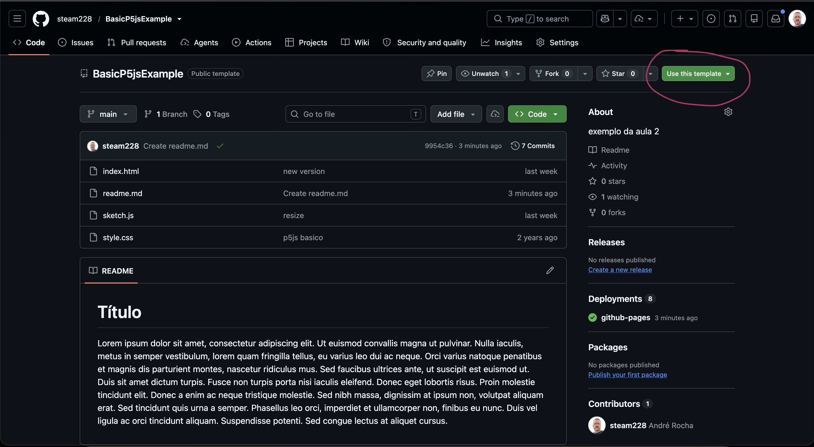
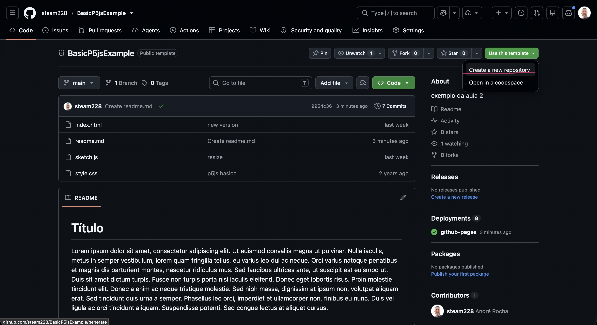
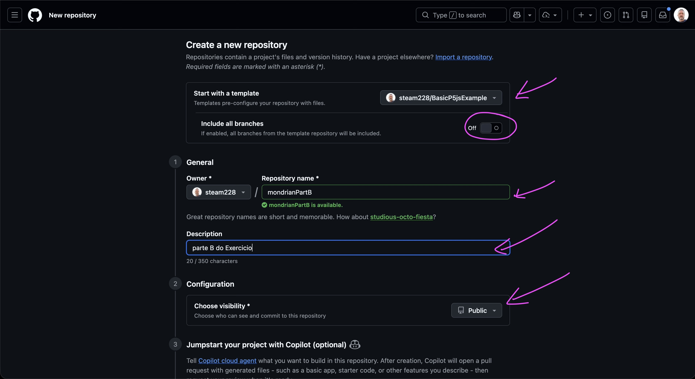
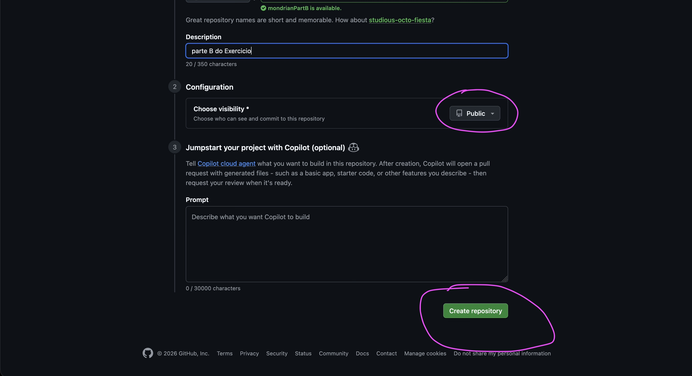

# Configuração Base

## Configuração inicial (só uma vez)

### 1. Instalar VSCode

Descarregar e instalar: [code.visualstudio.com](https://code.visualstudio.com/)

### 2. Criar conta GitHub

Registar em: [github.com](https://github.com/)

### 3. Instalar a extensão Live Server no VSCode

### 4. Instalar GitHub Desktop

Descarregar em: [desktop.github.com](https://desktop.github.com/)

---

## Workflow — criar um novo projeto

Cada vez que queres começar um novo projeto P5.js:

**1.** Ir ao repositório template:
[github.com/steam228/BasicP5jsExample](https://github.com/steam228/BasicP5jsExample)

**2.** Clicar em **"Use this template"** → **"Create a new repository"**

**3.** Dar um nome ao repositório e criar

**4.** Clicar em **"Open with GitHub Desktop"** (ou clonar pela app do GitHub Desktop)

!!! warning "Atenção"
    Escolher bem a pasta de destino — é lá que o projeto vai ficar.

**5.** Abrir a pasta no VSCode e editar o `sketch.js`

---

## Vídeo de referência (configuração original)

