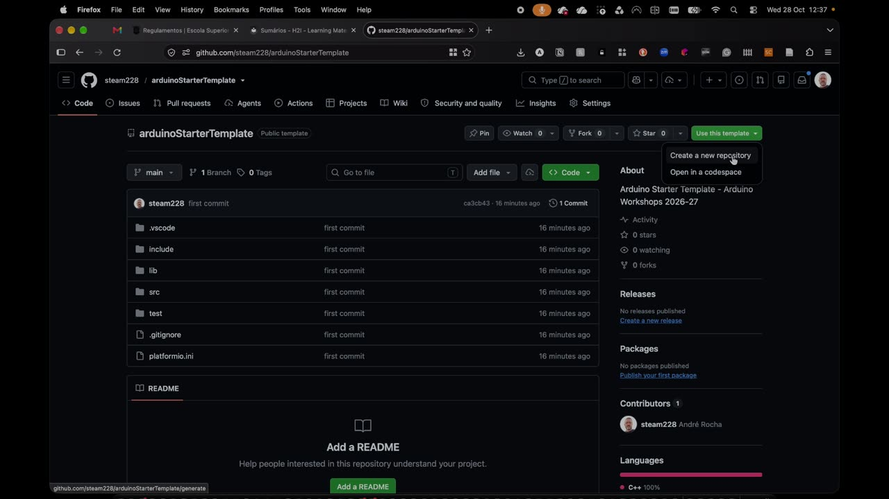
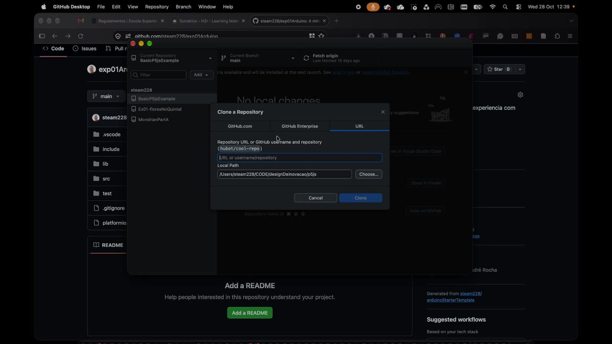
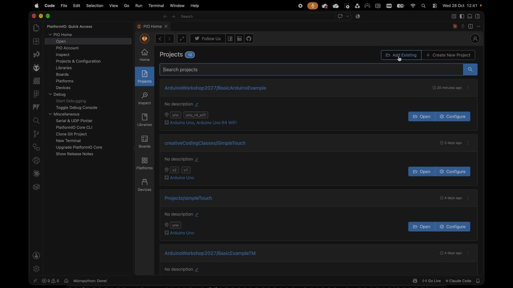
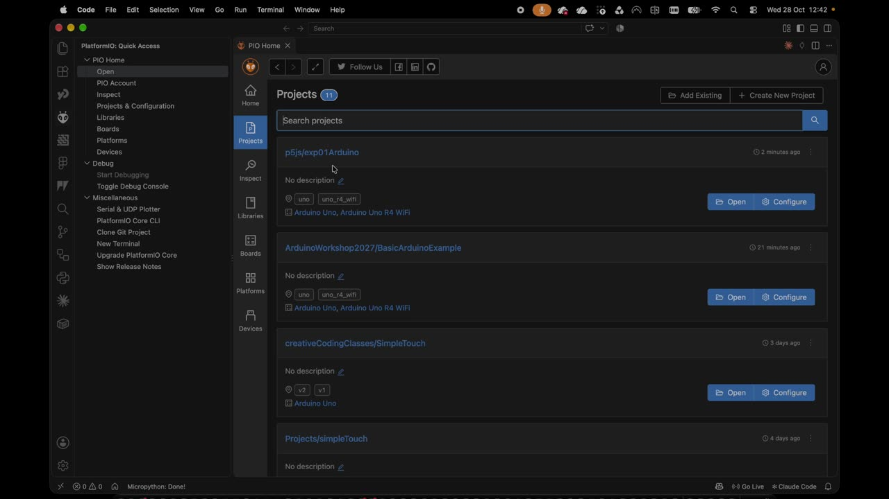
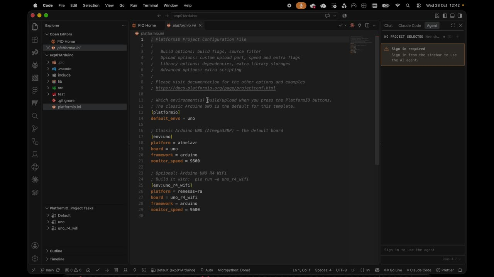
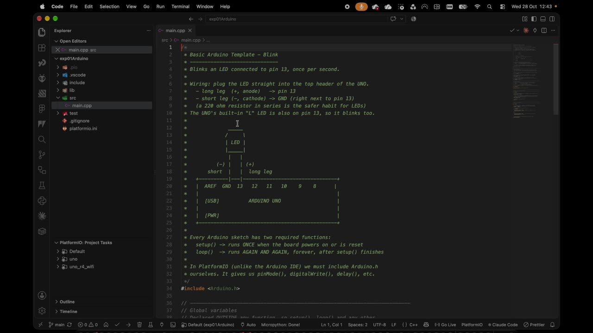

# Configuração Base

O processo é muito semelhante ao do [P5.js](CodigoCriativocomP5JS.md): partimos de um repositório template no GitHub, clonamo-lo com o GitHub Desktop e trabalhamos no VSCode — aqui com a extensão **PlatformIO**.

## Configuração inicial (só uma vez)

### 1. VSCode, conta GitHub e GitHub Desktop

Se já configuraste o P5.js, já tens tudo isto. Caso contrário, ver [Código Criativo com P5JS](CodigoCriativocomP5JS.md).

### 2. Instalar a extensão PlatformIO IDE no VSCode

1. No VSCode, abrir as **Extensões** (`Cmd+Shift+X` no Mac, `Ctrl+Shift+X` no Windows)
2. Pesquisar **PlatformIO IDE** e clicar **Install**
3. Esperar que a instalação termine (na primeira vez demora alguns minutos) e reiniciar o VSCode se for pedido

Fica disponível o ícone do PlatformIO (a "cabeça de formiga") na barra lateral e o **PIO Home**.

!!! tip "Placas compatíveis (clones)"
    Algumas placas compatíveis com Arduino (com chip CH340) precisam de um driver USB para o computador as reconhecer. Se a placa não aparecer ao fazer upload, é o primeiro sítio a verificar.

---

## Workflow — criar um novo projeto

https://youtu.be/a2OlBPXn-xs

Cada vez que queres começar uma nova experiência com Arduino:

**1.** Ir ao repositório template:
[github.com/steam228/arduinoStarterTemplate](https://github.com/steam228/arduinoStarterTemplate)

**2.** Clicar em **"Use this template"** → **"Create a new repository"**

**3.** Dar um nome ao repositório (ex.: `exp01Arduino`) e, se quiseres, uma descrição. Visibilidade **Public**; "Include all branches" pode ficar desligado. Clicar **Create repository** — o repositório é uma cópia exata do template, já em teu nome.

**4.** Em **Code** → **"Open with GitHub Desktop"** (ou, no GitHub Desktop, **File → Clone repository** e escolher o repositório na lista GitHub.com)

!!! warning "Atenção"
    Escolher bem a pasta de destino (**Local Path**) **antes** de clicar em Clone — por exemplo, uma pasta `Arduino` separada da de `P5JS`. Se moveres a pasta depois, o GitHub Desktop deixa de a reconhecer.

**5.** Abrir o projeto **pelo PlatformIO** (e não arrastando a pasta, como no P5.js): **PIO Home → Projects → Add Existing** → escolher a pasta do repositório → **Open**

!!! note "Se o projeto não aparecer"
    Por vezes a lista não atualiza: sair de **Projects** e voltar a entrar.

**6.** Na lista de projetos, clicar em **Open** no teu projeto — o VSCode abre-o como projeto PlatformIO.

---

## Editar o código

https://youtu.be/SJY6BROp03w
### `platformio.ini` — configuração do projeto

É o primeiro ficheiro que abre. Define a placa e a velocidade de comunicação:

- `default_envs = uno` — a placa por defeito é o **Arduino UNO** (a que usamos nas primeiras experiências)
- `[env:uno_r4_wifi]` — opção secundária para o **Arduino UNO R4 WiFi**
- `monitor_speed = 9600` — velocidade do monitor série

Para mudar de placa, o ideal é usar **PIO Home → Projects → Configure**, em vez de editar o ficheiro à mão.
### `src/main.cpp` — o ficheiro que se edita

O template é um **Blink** (LED a piscar no pino 13) escrito de propósito de forma "completa", para mostrar as várias partes de um programa Arduino:

| Parte | No template | O que faz |
| ----- | ----------- | --------- |
| Comentários | `/* ... */` e `// ...` | Tudo o que é comentário não é executado — **lê-os**: explicam cada linha |
| Biblioteca | `#include <Arduino.h>` | Obrigatório no PlatformIO (no Arduino IDE é implícito) |
| Constante | `const int ledPin = 13;` | O pino do LED. Equivale ao `#define LED_PIN 13` que usámos na aula |
| Variável inteira | `int blinkDelay = 500;` | Tempo (ms) que o LED fica ligado/desligado |
| Variável booleana | `bool ledIsOn = false;` | Só pode ser `true` ou `false` — guarda o estado do LED |
| Função própria | `void sayHello() { ... }` | `void` = não devolve valor; `()` = sem parâmetros. Envia uma frase ao computador |
| `setup()` | `pinMode(...)`, `Serial.begin(9600)`, `sayHello()` | Corre **uma vez**: define o pino como saída, abre a comunicação série e chama a função |
| `loop()` | `ledIsOn = !ledIsOn;` + `if / else` + `delay(blinkDelay)` | Corre **para sempre**: inverte o estado, liga ou desliga o LED e espera |

!!! tip "Atribuir vs. comparar"
    `=` atribui um valor; `==` compara. `ledIsOn = !ledIsOn;` atribui a `ledIsOn` o seu contrário (`!` = negação). `if (ledIsOn)` é a forma abreviada de `if (ledIsOn == true)`.

`Serial.println(...)` envia mensagens (ou valores de sensores) pelo cabo USB para o computador — é assim que, mais à frente, ligamos o Arduino ao P5.js.

---

## Compilar, carregar e ver mensagens

Com o Arduino ligado por USB, na barra inferior do VSCode (PlatformIO):

- **✓ Build** — compila e verifica erros
- **→ Upload** — compila e envia o programa para a placa
- **🔌 Serial Monitor** — mostra as mensagens enviadas pelo `Serial.println` (a velocidade tem de coincidir com `monitor_speed`)

## Guardar no GitHub

No **GitHub Desktop**: escrever uma mensagem em **Summary** → **Commit to main** → **Push origin**.

---

## Referências

- [Arduino Reference](https://www.arduino.cc/reference/en/) — todas as funções da linguagem Arduino
- [Documentação PlatformIO](https://docs.platformio.org/) — configuração de projetos e placas
- [Template base no GitHub](https://github.com/steam228/arduinoStarterTemplate)
