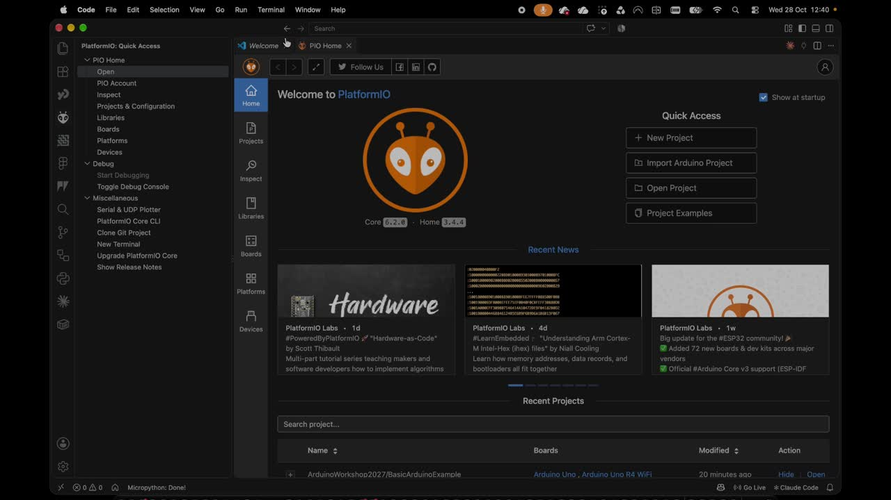

# Página de Recursos de Apoio à Documentação de Projetos

## Desenho Paramétrico

### 100 - Introdução ao Autodesk Fusion 360:

[100IntroFusion360](100IntroFusion360.md)

### 200 - Introdução à Carpintaria Digital em Autodesk Fusion 360:

[200CarpDigitalFusion360](200CarpDigitalFusion360.md)

## Programação

### Código Criativo com P5.js

[Configuração base P5.js](CodigoCriativocomP5JS.md) — template, GitHub Desktop e VSCode

### Computação Física com Arduino

[Configuração base Arduino (PlatformIO)](ComputacaoFisicaArduino.md) — extensão PlatformIO, template, clonar, abrir e editar o projeto

## Documentação

#### [Markdown Resources][markdown](markdown.md)